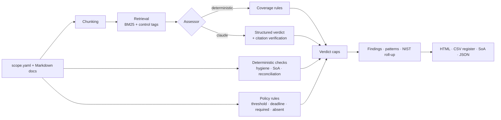

# Tranquera

**Deterministic ISO/IEC 27001:2022 and NIST CSF 2.0 gap analysis: policy rules tested against evidence, with findings you can trace to a row or a date.**

Tranquera reads an organization's policies and evidence (Markdown with YAML front matter), assesses
every Annex A control, reconciles what policies *promise* against what evidence *shows*, tests the rules each policy sets
(targets, deadlines, mandatory records, leavers) against the evidence tables, and produces
the outputs a GRC team actually works with: an executive report, a findings register with corrective
actions, owners and due dates, and a Statement of Applicability.

> *Tranquera* is the gate of an Argentine ranch: what gets through and what doesn't.


## Why another compliance tool?

Most "AI compliance" demos ask a model whether a policy is good. An auditor needs something else:
results that are reproducible, explainable and cheap to rerun every month. Tranquera works fully
offline, with no AI and no API key.

- **Policy rules tested row by row.** A policy declares what its evidence must show; Tranquera tests
  it against the evidence tables and lists the exact rows that fail (see [rules](#rules-testing-operation-without-ai)).
- **Designed vs. operating.** A control backed only by a policy is *partial*. It is *met* only when
  linked evidence shows it running.
- **Deterministic reconciliation.** Policies declare periodic commitments (quarterly access reviews,
  restore tests, monthly scans). Tranquera checks each complete calendar period against the evidence
  log and lists exactly which periods are missing, no AI involved.
- **Verdicts can't look better than their weakest evidence.** A control that relies on an expired or
  draft document, or that has a missed commitment, is capped at *partial*.
- **Systemic patterns.** Findings are grouped by root cause; a cause repeated three or more times is
  reported as a process failure, not as isolated errors.
- **One assessment, two frameworks.** Annex A results roll up into the 106 NIST CSF 2.0 subcategories.
- **Optional second opinion.** A Claude assessor can review content; every verdict must quote the
  documents verbatim, quotes are checked mechanically and unverified ones are discarded. It is never
  needed for the core analysis.

## Quick start

```bash
pip install "tranquera[app] @ git+https://github.com/Renzodigu/tranquera"
tranquera demo                      # offline, no AI: fictitious fintech, Spanish report
tranquera demo --lang en            # English report
open tranquera-report/report.html
```

From a clone:

```bash
pip install -e ".[dev,app,claude]"
pytest -q
tranquera analyze path/to/company --out report/
streamlit run app/streamlit_app.py  # web demo
```

### Optional: Claude review

```bash
export ANTHROPIC_API_KEY=...        # never commit it
tranquera analyze path/to/company --assessor claude --controls 5.18,8.13   # try a few controls first
tranquera analyze path/to/company --assessor claude                        # full run: one call per control
```

The model defaults to `claude-sonnet-5-5` and can be changed with `--model` or `TRANQUERA_MODEL`.
Answers are cached in `.tranquera-cache/`, so re-running the same analysis costs nothing.

### Use it in CI

`--fail-on high` exits with code 1 when there is a high-severity finding, so a documentation
repository can block merges that leave, for example, an expired incident policy.

## Demo: Ñandú Pagos S.A.

`src/tranquera/demo/nandu-pagos` is a **fictitious** Buenos Aires payments company (100 % on AWS,
140 employees) with 9 policies, 8 evidence records and a Statement of Applicability. Problems were
planted on purpose to check what the tool catches. Deterministic run (no AI), as of 2026-10-20:

| | |
| --- | --- |
| Applicable controls | 88 (5 excluded in the SoA) |
| Met / partial / not met | 8 / 49 / 31 |
| Findings | 85 (9 high) in 4 systemic patterns |
| Commitments reconciled | 2 of 6 |
| Policy rules passed | 1 of 5 |

Sample reports: [`examples/demo-es`](examples/demo-es) and [`examples/demo-en`](examples/demo-en)
(HTML report, findings register CSV, SoA CSV, JSON).

| Planted problem | Caught by | Result |
| --- | --- | --- |
| Quarterly access review done once in 2026 | Reconciliation | High: periods Q4 2025, Q2 2026, Q3 2026 missing |
| Quarterly restore test, last one Nov 2025 | Reconciliation | High: Q1–Q3 2026 missing |
| Monthly vulnerability scan skipped Jul and Aug 2026 | Reconciliation | Medium: 10 of 12 months |
| Annual incident drill, last one in 2024 | Reconciliation | High |
| Incident policy review overdue since 2025-03-01 | Hygiene | High; caps every control it supports at partial |
| 2019 password policy still published, superseded | Hygiene | Remove |
| Supplier policy without owner | Hygiene | Fix |
| Secure development policy still a draft | Hygiene | Fix; caps every control it supports at partial |
| SoA excludes 8.11 without justification | SoA | Fix |
| No business continuity, threat intelligence or DLP | Assessment | Not met |
| Only 62 % of staff completed the annual training | Rule `threshold` | 6.3 capped at partial: 62 vs. target 95 |
| Two critical vulnerabilities open beyond the 7-day SLA | Rule `deadline` | VULN-26-017 and VULN-26-018, open for 41 days |
| High-severity incident closed without post mortem | Rule `required` | INC-2026-02 |
| Three leavers still have an active SSO account | Rule `absent` | mrojas, jcabral, pvillalba (a leaver from yesterday is still inside the 24-hour grace period) |

Every planted problem is caught without AI. Version 0.1 needed Claude for the last four; 0.2 turns
them into rules the policy owner can read and the auditor can rerun.

## Rules: testing operation without AI

Policies say things like "critical vulnerabilities are fixed in 7 days". Tranquera lets the policy
state that as a rule, and tests it against the Markdown tables already kept in the evidence records:

```yaml
# POL-08 front matter
rules:
  - id: REG-02
    control: "8.8"
    description: Critical vulnerabilities remediated in 7 days
    check: deadline
    evidence: EVD-03              # the evidence record that holds the table
    where: {Severidad: Crítica}   # rows to test (accent- and case-insensitive)
    start: Detectada
    end: Remediada                # empty = still open, aged until the assessment date
    max_days: 7
```

| Check | Tests | Typical use |
| --- | --- | --- |
| `threshold` | a metric in the evidence front matter against `min` / `max` | training completion, MFA coverage, backup success rate |
| `deadline` | every matching row closed within `max_days` | vulnerability SLAs, incident response, access request approval |
| `required` | every matching row has an accepted value in a column | post mortems, approvals, risk acceptance sign-off |
| `absent` | keys from one table must not appear in another | leavers vs. active accounts, retired assets vs. inventory |

A failed rule becomes a finding that lists the failing rows and caps the control at *partial*. A rule
that cannot be evaluated (missing table, column or record) is reported as a finding too, never ignored.
Full reference: [docs/document-format.md](docs/document-format.md#rules).

## How it works



1. **Ingest** — documents are split by headings; front matter gives type, owner, status, review date,
   control tags, `supersedes`, commitments and execution dates.
2. **Retrieve** — for each control, the most relevant chunks by BM25 over Spanish and English
   keywords, boosted when the document is tagged with the control.
3. **Check** — review dates, owners, drafts, superseded documents, SoA justifications,
   commitment-by-period reconciliation and policy rules tested against evidence tables.
4. **Assess** — deterministic coverage rules, or (optionally) Claude with a forced structured answer
   (`met / partial / not_met / undetermined`, rationale, verbatim citations, gaps, contradictions,
   one corrective action: add, fix or remove).
5. **Cap and register** — verdicts are capped by deterministic findings; each gap becomes a finding
   with severity (from control criticality), action, owner and due date (30/90/180 days).
6. **Roll up** — Annex A results map onto NIST CSF 2.0 subcategories ([details](docs/mapping.md)).

Document format: [docs/document-format.md](docs/document-format.md).

## Limitations

- Annex A only. Clauses 4 to 10 (risk assessment, internal audit, management review) are not
  assessed yet, so many CSF *Govern* subcategories show as "not mapped".
- The deterministic assessor judges coverage, and rules test only what a policy states as a rule.
  Content quality (is this policy any good?) still needs an auditor or the optional Claude review.
- Claude mode is covered by tests with a fake client; results from a live model still need an
  auditor's review. It supports professional judgment, it does not replace it.
- The ISO ↔ NIST mapping is the author's, indicative, not NIST's official informative reference.

## Copyright and data

ISO/IEC 27001 is copyrighted by ISO/IEC: this repository contains only control identifiers and
short titles written in the author's own words. NIST CSF 2.0 is a U.S. Government work. All company
data in the demo is invented.

## Roadmap

- [x] Policy rules tested against evidence tables (0.2)
- [ ] CSV evidence (exports from Jira, the IdP or the scanner) next to Markdown tables
- [ ] Clauses 4–10 as assessable requirements
- [ ] Ingest PDF and DOCX policies
- [ ] Argentine regulation pack (Ley 25.326, BCRA communications)
- [ ] Questionnaire mode: answer vendor security questionnaires from the same evidence

## License

MIT. Built by Renzo Di Guglielmo ([LinkedIn](https://www.linkedin.com/in/renzo-di-guglielmo-ciberseguridad-redes/)).
